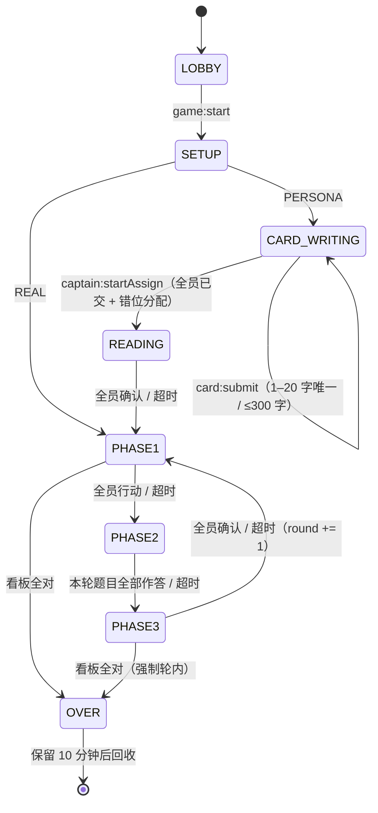
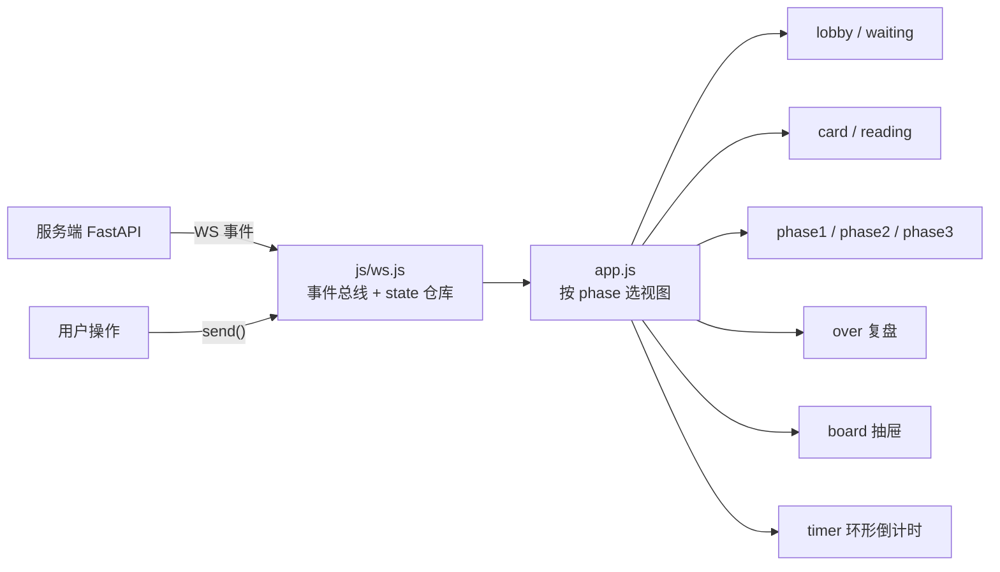

# 公演交付报告（第 1–4 周总收）

> 状态：**Step 4.1–4.6 全部完成，无 BLOCKED**。
> 一句话：`docker compose up -d --build` 之后把域名发给朋友就能开局；不配 LLM 也能人机对局。

---

## 1. 功能清单（可交付状态）

| 能力 | 状态 | 入口 |
| --- | --- | --- |
| 建团/入场（6 位码） | ✅ | 入口页 |
| 多房间并行（互不干扰） | ✅ | 各自房号 |
| 断线重连（座位保留、快照恢复） | ✅ | 自动（localStorage token） |
| 心跳（20s ping / 60s 判掉线） | ✅ | 自动 |
| REAL 三阶段循环 + 冷却 + 强制提交 | ✅ | 团长台「猜真人」 |
| PERSONA 写卡 → 错位分配 → 读卡 → 三阶段 | ✅ | 团长台「人设卡」 |
| AI 陪演（1–2 个，写卡/提问/作答/推理） | ✅ | 团长台「+1 / +2 AI」 |
| LLM 接入（OpenAI 兼容，超时兜底） | ✅（需自填 key） | `game/.env` |
| 观众板（编号→真人/卡名，草稿/呈交） | ✅ | 顶栏「观众板」 |
| 环形倒计时（本地算，末 10s 呼吸） | ✅ | HUD |
| 赛后复盘（真实映射 + 名场面时间线） | ✅ | 谢幕页 |
| 响应式（桌面双栏 / 移动单栏 100dvh） | ✅ | 自动 |
| Docker / compose 部署 | ✅ | `Dockerfile`、`docker-compose.yml` |
| 自动化测试 200 条 | ✅ | `bash scripts/selftest.sh` |

---

## 2. 架构

### 2.1 后端状态机（Mermaid）



### 2.2 前端数据流



要点：**前端不做业务判断**。阶段推进、合法性、冷却全部由服务端裁决；前端只把 `state` 渲染出来。

---

## 3. 测试结果

```
$ bash scripts/selftest.sh
200 passed
```

| 周 | 文件 | 用例 |
| --- | --- | --- |
| 第 1 周 | `test_step1..step8` | 64 |
| 第 2 周 | `test_week2_step{A1,A2,A3,B1..B7}` | 64 |
| 第 3 周 | `test_week3_step1..7` | 36 |
| 第 4 周 | `test_week4_step2_replay`（4）· `step3_ui`（23）· `step4_security`（6）· `step4_stress`（3） | 36 |

第 4 周共 36 条，新增覆盖：
- **UI 冒烟**：17 个静态资源全 200；`#stage / #board / #timer / #hud / #view / #side / #feed / #roster` 等容器存在；`app.js` 引用了全部视图模块；每个模块确实是 ES Module；有 Playwright 时真开浏览器并断言控制台无报错（无则退化为静态断言）。
- **复盘**：`game:over.timeline` 结构、`stats`、四类高亮（超时 / 自曝 / 神准提问 / 开场第一问）。
- **安全**：`phase:changed` 不含映射；`persona:assigned` 字段白名单；重连快照不含他人看板/卡；非法操作矩阵全部被拦。
- **压力**：8 路并发两轮不崩；阶段超时不重复跳；反复断线重连后仍可开局。

手动压测脚本（本机实测）：

```
$ python scripts/stress_ws.py --players 8 --rounds 2
房间 214288，加入 8 人…
开局成功，用时 0.00s
第 1 轮完成 / 第 2 轮完成
phase1→phase3  n=2 median=0.01 max=0.02
```

---

## 4. 遇到的坑与解法

| # | 坑 | 根因 | 解法 |
| --- | --- | --- | --- |
| 1 | `.env` 明明放了却不生效 | `Path(__file__).parents[2]` 指到了项目根，不是 `game/` | 改成 `game/.env` → `cwd/.env` → dotenv 默认搜索，并打印实际读到的文件 |
| 2 | 秒数校验把 AI 延迟配置全挡掉 | `patched()` 统一要求 `1..600` | AI 相关字段放开到 `0..600` |
| 3 | 测试里 `setup:config` 被拒却静默继续 | 助手没检查 `error` 回帧 | 配置被拒直接断言失败 |
| 4 | AI 不参与「阅读示意 / 回放确认」会卡死全员门槛 | 门槛按在线玩家算 | 阅读阶段 AI 视为已示意、回放 1–3s 自动确认 |
| 5 | `/debug/ai` 决策日志跨房间串味 | 日志是全局数组 | 测试按 `room` 过滤；接口返回按房间分组 |
| 6 | 4 人局几乎不可能「自然全对」（没有必赢推理路径） | 游戏设计的必然 | 调试口在 `AI_DEBUG=1` 时提供 `truth`，仅用于自动化收尾 |
| 7 | 视图重渲染会打断输入框 | 每个 `room:state` 都全量重绘 | 只在「阶段/轮次/关键标记」变化时重绘，其余走 `patchHints()` |
| 8 | `@import` 追加在 style.css 末尾被浏览器忽略 | CSS 规范要求 `@import` 必须在文件最前 | 改成 `index.html` 里两个 `<link>` |
| 9 | 环形倒计时让浏览器观察快照频繁失效（自动化操作报错） | 200ms 定时器持续改 DOM | 自动化改用 DOM 定向操作（fill/click），不用整页脚本 |
| 10 | 卡名用 `sanitize_text` 静默截断到 20 字 | 复用了短文本工具 | 改为显式校验并返回 `CARD_NAME_INVALID` |

---

## 5. 交付物清单

| 文件 | 说明 |
| --- | --- |
| `README.md` | 玩法 / 本地启动 / `.env` / 目录 / WS 协议 / 测试 / 部署（Railway·Fly·Vercel） |
| `DEMO.md` | 4 个标签页演示脚本（REAL / PERSONA+AI / 重连 / 压测） |
| `Dockerfile` · `docker-compose.yml` · `.dockerignore` · `.gitignore` | 一键部署 |
| `env.example` | LLM 配置模板 |
| `reports/week1..week4` + 本文件 | 全过程交付报告 |
| `scripts/stress_ws.py` | 8 路并发压测脚本 |
| `scripts/selftest.sh` | 一键全量测试 |

## 6. 已知限制（发朋友前先知道）

1. **单实例**：房间在内存里，重启即清空，不能多 worker/多副本。
2. 无账号、无敏感词过滤、无频控；昵称与卡面内容请自辨。
3. AI 的「人设拟合度」靠 Prompt，模型跑偏会说人话外的话；无二次校验。
4. `AI_DEBUG=1` 会暴露 Prompt 与真值，生产必须关。
5. 移动端体验可用（单栏 + 44px 触控目标），但看板抽屉在小屏仍需上下滚动。

## 7. 后续（第 5 周备选）

1. 注册表外置（Redis）+ 多副本，房间加锁。
2. AI 策略升级：跨轮记忆 + 主动追问 + 置信度收敛，提高「无外挂也能赢」的胜率。
3. 账号与战绩（SQLite/Postgres），赛后时间线可分享成图片。
4. 观战模式（第 9 个连接只读，看所有人看板）。
5. 内容安全：敏感词、频率限制、昵称/卡面审核。
